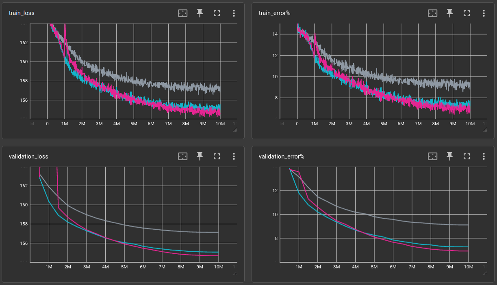
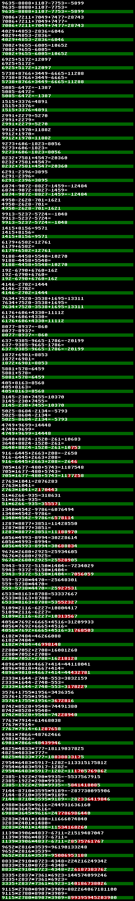

# Math with tiny language models

[experiments/textmask/math/convtext-math.yml @ 382c4113](https://github.com/defgsus/nn-experiments/blob/382c411309f12f9ae3ef6baab282654f97dd7997/experiments/textmask/math/convtext-math.yml)

```shell
python exp.py experiments/textmask/math/convtext-math.yml results -ec matrix_id matrix_slug compression-ratio -ic "train_error%" "validation_error%" -sc "validation_error%-"
```

|   bs | opt   |     lr |   len |   lnum | nops   |   l |   ch |   ks | dil                                 | act   |   validation loss (10,000,000 steps) |   train_error% |   validation_error% |   model params |   train time (minutes) |   throughput |
|-----:|:------|-------:|------:|-------:|:-------|----:|-----:|-----:|:------------------------------------|:------|-------------------------------------:|---------------:|--------------------:|---------------:|-----------------------:|-------------:|
|   64 | AdamW | 0.0005 |    40 |   9999 | 1,3    |   6 |   64 |   13 | 1,2,3,4,5,1                         | gelu  |                              157.126 |         8.7793 |             9.12669 |        336,256 |                     24 |      6,944/s |
|   64 | AdamW | 0.0005 |    40 |   9999 | 1,3    |  12 |   64 |   13 | 1,2,3,4,5,1,1,2,3,4,5,1             | gelu  |                              155.068 |        7.36328 |               7.291 |        656,128 |                  37.11 |      4,491/s |
|   64 | AdamW | 0.0005 |    40 |   9999 | 1,3    |  18 |   64 |   13 | 1,2,3,4,5,1,1,2,3,4,5,1,1,2,3,4,5,1 | gelu  |                              154.686 |        6.86035 |             6.94218 |        976,000 |                  48.52 |      3,434/s |




