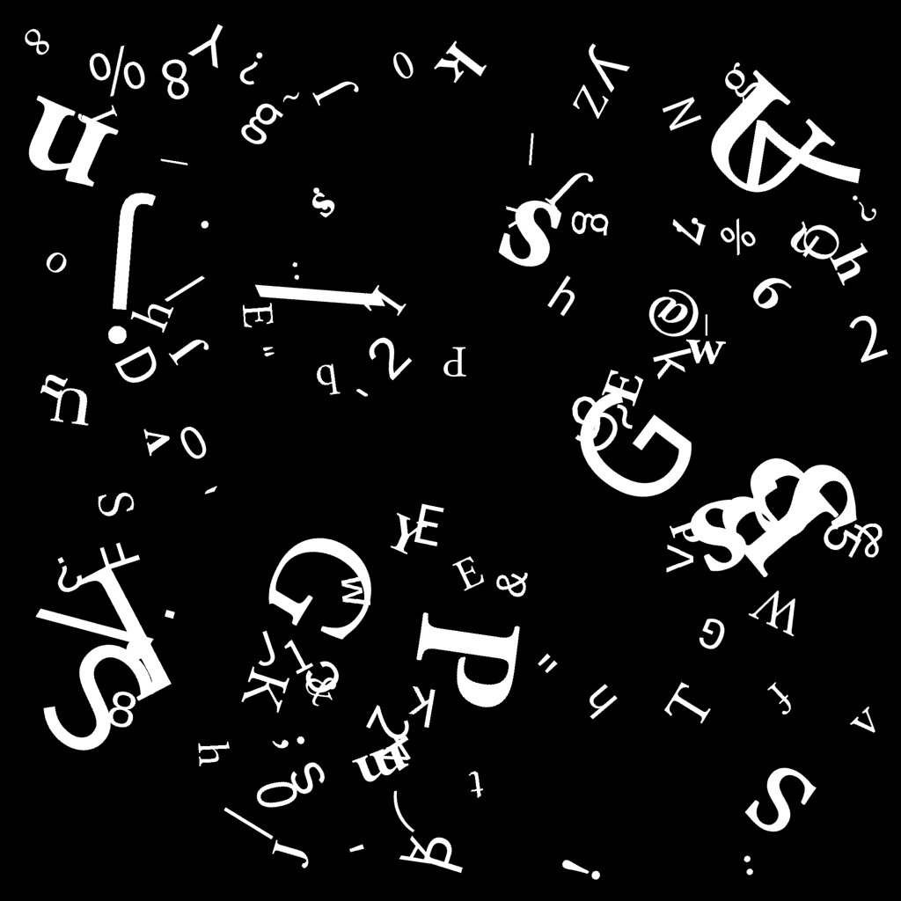
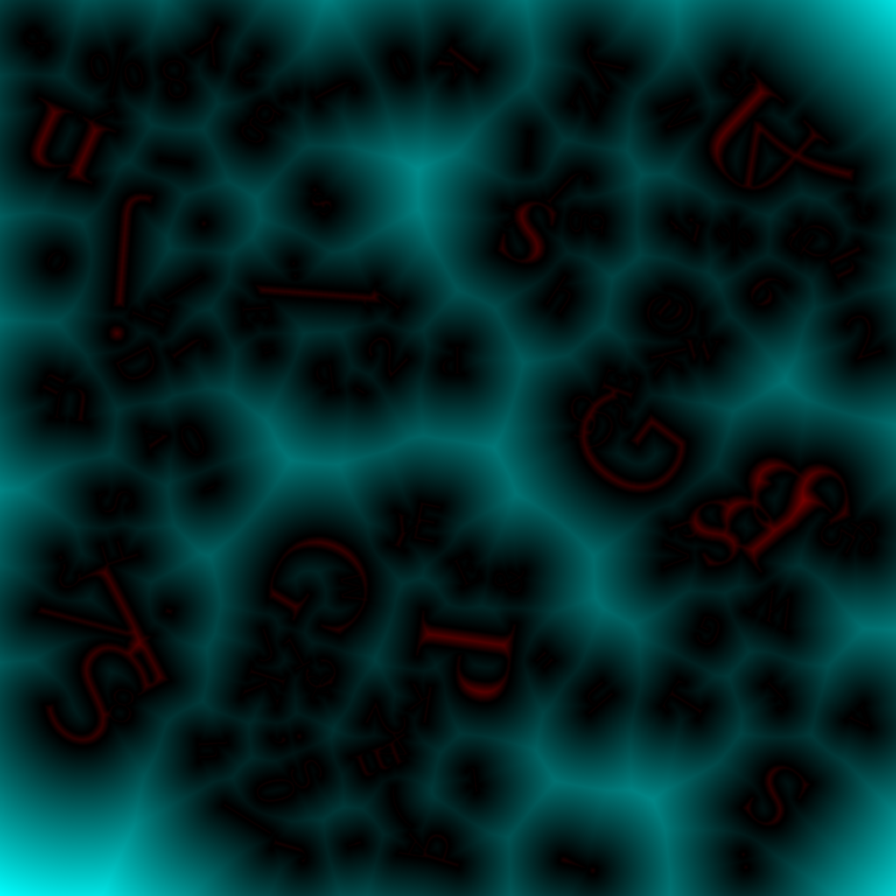
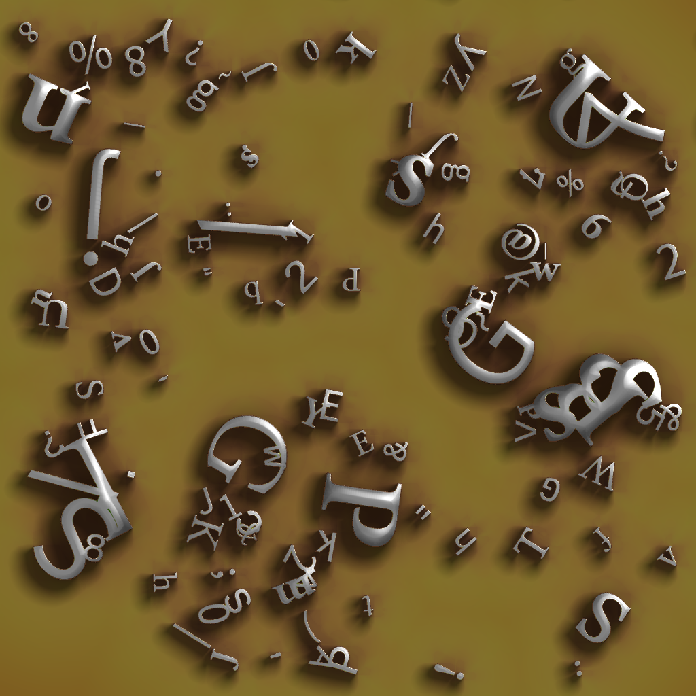
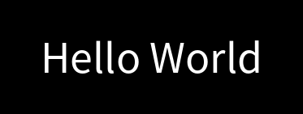
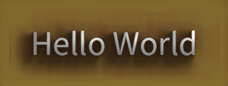
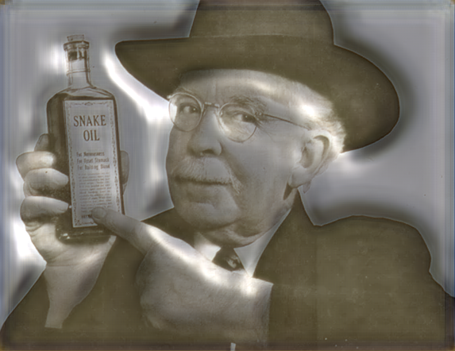
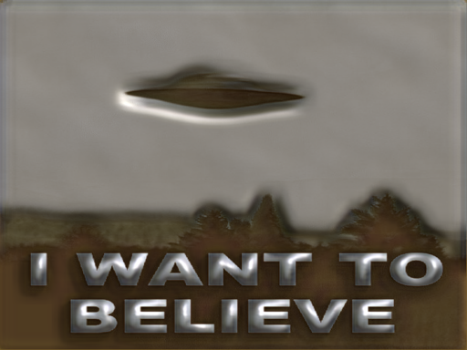

# Ambient Occlusion with a Neural Network

Ambient Occlusion is a computer graphics technique that adds nice, smooth shadows where appropriate, like in the corners of things. The brute-force approach is very expensive and i've trained a small neural network to approximate those shadows.

This is a quick continuation of the ["Shiny Tubes"](2024-12-03-shiny-tubes.md) experiment. It uses the same UNet-style, classic CNN model, just the source and target images are different.

The source is, again, just white shapes on black:



From this, i calculate a *Signed Distance Field*. That's not (but related to) a [Signed Distance Function](https://en.wikipedia.org/wiki/Signed_distance_function) but a pre-calculated 2d-array, where each pixel holds the distance
to the closest outline of the white shapes. Below displayed with cyan for positive and red for negative distances:



This procedure can be computationally expensive so i'm using an approximation algorithm called Dead Reckoning (paper [10.1.1.102.7988](https://citeseerx.ist.psu.edu/viewdoc/download?doi=10.1.1.102.7988&rep=rep1&type=pdf), shadertoy example [4lKGDt](https://www.shadertoy.com/view/4lKGDt)). Once the minimum distances are calculated, one can use all the "cheap" ray-marching render techniques as popularized by [iQ](https://iquilezles.org/articles/) on [shadertoy.com](https://shadertoy.com).

I'm a bit out of practice but eventually wrote an okay-ish shader. The distance function in the shader defines a plane and the shapes/letters from the pre-calculated distance field are *made solid* and placed on the plane to cast shadows and occlusion.



There's also some simple [phong lighting](https://en.wikipedia.org/wiki/Phong_reflection_model). The full code to render the source and target images is in [scripts/ao_dataset/](../../scripts/ao_dataset/).

To train the network, it gets random 128x128 cuts from the source images as input and the training loss is the *mean absolute error* of it's output to the target image cuts. I used batch size of 64, AdamW optimizer with learnrate 0.003 and a model that looks like this:

```
Module(
  (module): ResConv(
    (encoder): ModuleDict(
      (layer_1): ConvLayer(
        (bn): BatchNorm2d(3, eps=1e-05, momentum=0.1, affine=True, track_running_stats=True)
        (conv): Conv2d(3, 32, kernel_size=(7, 7), stride=(1, 1))
        (act): GELU(approximate='none')
      )
      (layer_2): ConvLayer(
        (bn): BatchNorm2d(32, eps=1e-05, momentum=0.1, affine=True, track_running_stats=True)
        (conv): Conv2d(32, 32, kernel_size=(7, 7), stride=(1, 1))
        (act): GELU(approximate='none')
      )
      (layer_3): ConvLayer(
        (bn): BatchNorm2d(32, eps=1e-05, momentum=0.1, affine=True, track_running_stats=True)
        (conv): Conv2d(32, 32, kernel_size=(7, 7), stride=(2, 2))
        (act): GELU(approximate='none')
      )
      (layer_4): ConvLayer(
        (bn): BatchNorm2d(32, eps=1e-05, momentum=0.1, affine=True, track_running_stats=True)
        (conv): Conv2d(32, 32, kernel_size=(7, 7), stride=(1, 1))
        (act): GELU(approximate='none')
      )
      (layer_5): ConvLayer(
        (conv): Conv2d(32, 32, kernel_size=(7, 7), stride=(1, 1))
      )
    )
    (decoder): ModuleDict(
      (layer_1): ConvLayer(
        (bn): BatchNorm2d(32, eps=1e-05, momentum=0.1, affine=True, track_running_stats=True)
        (conv): ConvTranspose2d(32, 32, kernel_size=(7, 7), stride=(1, 1))
        (act): GELU(approximate='none')
      )
      (layer_2): ConvLayer(
        (bn): BatchNorm2d(32, eps=1e-05, momentum=0.1, affine=True, track_running_stats=True)
        (conv): ConvTranspose2d(32, 32, kernel_size=(7, 7), stride=(1, 1))
        (act): GELU(approximate='none')
      )
      (layer_3): ConvLayer(
        (bn): BatchNorm2d(32, eps=1e-05, momentum=0.1, affine=True, track_running_stats=True)
        (conv): ConvTranspose2d(32, 32, kernel_size=(7, 7), stride=(2, 2))
        (act): GELU(approximate='none')
      )
      (layer_4): ConvLayer(
        (bn): BatchNorm2d(32, eps=1e-05, momentum=0.1, affine=True, track_running_stats=True)
        (conv): ConvTranspose2d(32, 32, kernel_size=(7, 7), stride=(1, 1))
        (act): GELU(approximate='none')
      )
      (layer_5): ConvLayer(
        (conv): ConvTranspose2d(32, 3, kernel_size=(7, 7), stride=(1, 1))
      )
    )
  )
)
```

Encoder and decoder are symmetric and the output of each encoder layer `N` is added to the input of each decoder layer `6-N`, hence it's a [UNet](https://en.wikipedia.org/wiki/U-Net). The 3rd layer has a *stride* of 2, so it
halfs the resolution of the input for further processing which gives the network a larger [receptive field](https://en.wikipedia.org/wiki/Receptive_field). With the chosen kernel-size of 7, it means each image pixel can be affected by others that are at most 85 pixels away. The first layer processes the 128x128 input and the 5th layer
outputs a 43x43 feature space which is then decoded back to 128x128.

Training went on smoothly and train as well as validation loss got down to around 0.02, which is quite okay for mean absolute error on images. The above network only has 411K parameters so i would not expect much better results. 

Now the fun part. Get any white on black image



and make it soft-shadowed and shiny in milliseconds:



There is a hard border in the shadow on the left. It's about 50 pixels away from the left side of the `H`. I'm sure that the network architecture could be improved, also the stride of 2 could be removed while still somehow maintaining a large receptive field size. Strides (or pooling) are usually the reason for stripy artifacts in image CNNs.


As a first try, i'm quite happy. And it does some interesting things to photos:





